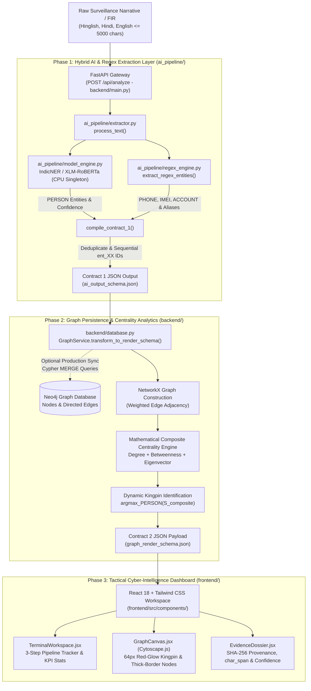

# CRIMI-NEX (KAVACH): AI-POWERED CRIMINAL NETWORK INTELLIGENCE & SYNDICATE DECONSTRUCTION PLATFORM

> **Confidential Defense & Law Enforcement Platform Reference Document**  
> **System Architecture, Technical Specification & Context-Injection Manual**  
> *Target Audience: Autonomous AI Agents, Core Software Architects, and Law Enforcement Intelligence Analysts.*

---

## 1. Project Overview

**Crimi-Nex** (operating under project codename **Kavach**, SIH26189) is an enterprise-grade, end-to-end intelligence platform engineered to ingest unstructured, code-mixed (Hinglish, native Devanagari Hindi, and English legal vernacular) police First Information Reports (FIRs), surveillance intercepts, call detail records (CDRs), and financial logs.

The platform autonomously:
1. **Extracts Real-World Entities:** Identifies operatives, contextual street aliases (*urf*, *alias*, *@*, *aka*), 10-digit Indian MSISDN mobile numbers, 15-digit hardware IMEIs, and institutional bank/hawala account numbers.
2. **Maintains Cryptographic Evidence Provenance:** Preserves court-admissible legal chains of custody by tagging every entity with SHA-256 document hashing, exact character offset spans (`char_span: [start, end]`), and model confidence scores (`ai_confidence`).
3. **Constructs Directed Relational Topologies:** Synthesizes inter-device communications, hardware bindings, and financial money trails conforming to **Contract 1** (`ai_output_schema.json`).
4. **Applies Graph Centrality Mathematics:** Ingests networks into Neo4j (via Cypher `MERGE`) and executes weighted NetworkX centrality graph algorithms to mathematically unmask the **Syndicate Kingpin** without heuristic string-matching hacks.
5. **Visualizes Tactical Topologies:** Streams payload conforming to **Contract 2** (`graph_render_schema.json`) into a modular dark-mode React.js + Tailwind CSS + Cytoscape.js dashboard.

---

## 2. System Architecture & End-to-End Data Journey

The complete data pipeline operates deterministically across five loosely coupled phases:



### Detailed Pipeline Stages
1. **Ingestion & Validation:** The client submits a raw text payload and optional case identifier (`doc_id`) via `POST /api/analyze`. The FastAPI router enforces a 5,000-character safety ceiling to avoid CPU memory spikes.
2. **AI Inference (Dev A):** `model_engine.py` runs a global singleton Hugging Face pipeline (`ai4bharat/IndicNER` with automated fallback to `Davlan/xlm-roberta-base-ner-hrl`) executing strictly on CPU (`device=-1`). It returns `PERSON` entities with model confidence probabilities and character offsets.
3. **Structured Regex Extraction (Dev B):** `regex_engine.py` executes high-performance pre-compiled regular expressions against the raw text to harvest Indian phone numbers, 15-digit IMEIs, and multi-bank account numbers.
4. **Contract 1 Compilation & Resolution:** `compile_contract_1()` merges deep-learning AI PERSON entities with regex aliases, deduplicates sub-token splits, assigns standardized sequential IDs (`ent_01`, `ent_02`, ...), and synthesizes relationships (device ownership, calls, fund transfers, account control).
5. **Persistence & Centrality Scoring (Team 3):** `backend/database.py` receives Contract 1. If Neo4j is configured, it executes Cypher `MERGE` transactions. Simultaneously, it constructs a weighted `networkx.Graph`, computes composite centrality, flags the highest-scoring `PERSON` node as Kingpin (`isKingpin: true`), and calculates the document's SHA-256 digest.
6. **Tactical Rendering (Frontend):** Cytoscape.js initializes a physics-driven CoSE layout, dynamically badging the Kingpin with high-priority visual styles while feeding user interaction taps into the legal Evidence Dossier panel.

---

## 3. Repository Directory Structure

```text
crimi-nex/
├── .env                              # Local environment variables (NEO4J, HF_TOKEN, etc.)
├── .gitignore                         # Python, Node.js, cache, and dist exclusions
├── README.md                          # Master context-injection architectural documentation
├── requirements.txt                   # Frozen Python backend & AI dependencies
├── test_nlp_pipeline.py               # Automated unittest suite verifying Contract 1 & 2
│
├── ai_pipeline/                       # Natural Language Processing & Extraction Engine
│   ├── __init__.py                    # Module export definitions
│   ├── benchmark.py                   # Performance benchmarking harness
│   ├── benchmark_indic.py             # Multilingual Indic benchmark evaluation
│   ├── BENCHMARK_RESULTS.md           # Benchmark accuracy & latency ablation results
│   ├── extractor.py                   # Master integration pipeline (process_text entry point)
│   ├── model_engine.py                # Lazy-loaded transformer pipeline (IndicNER / XLM-R)
│   └── regex_engine.py                # Regex parser, alias resolution & Contract 1 compiler
│
├── backend/                           # FastAPI Application & Graph Analytics Engine
│   ├── __init__.py                    # Module export definitions
│   ├── database.py                    # GraphService, Neo4j Cypher persistence & NetworkX math
│   └── main.py                        # FastAPI endpoints (/ and /api/analyze) with CORS
│
├── contracts/                         # Ground-Truth JSON Schemas & Golden Test Data
│   ├── ai_output_schema.json          # Contract 1: AI extraction schema definition
│   ├── graph_render_schema.json       # Contract 2: Frontend Cytoscape render schema definition
│   └── sample_input.txt               # Standard reference golden FIR narrative
│
└── frontend/                          # Modular React.js + Tailwind CSS Application (Vite)
    ├── index.html                     # Vite HTML entry point (Dark mode & typography links)
    ├── package.json                   # NPM manifest (React 18, Cytoscape, Lucide, Tailwind)
    ├── package-lock.json              # Frozen deterministic dependency tree
    ├── postcss.config.js              # PostCSS plugins for Tailwind CSS
    ├── tailwind.config.js             # Cyber-intelligence theme, colors, and shadows
    ├── vite.config.js                 # Vite bundler configuration (port 3000)
    └── src/
        ├── App.jsx                    # Root view manager (LandingPage <-> TerminalWorkspace)
        ├── index.css                  # Custom cyber scrollbar, grid, and Tailwind directives
        ├── main.jsx                   # React DOM bootstrapping root
        ├── components/
        │   ├── EvidenceDossier.jsx    # Side panel displaying SHA-256, char_span, and confidence
        │   ├── GraphCanvas.jsx        # Cytoscape.js wrapper with CoSE physics & Kingpin styling
        │   ├── LandingPage.jsx        # Executive summary view (metrics: 3 Weeks, ₹0, Launch CTA)
        │   └── TerminalWorkspace.jsx  # Main tactical dashboard with 3-step pipeline tracker
        └── services/
            └── api.js                 # Async fetch client for http://127.0.0.1:8000/api/analyze
```

---

## 4. Core Logic, Algorithms & Mathematical Formulations

### 4.1. Pre-Compiled Regular Expressions

The extraction layer relies on specialized regex patterns tuned for Indic and Romanized legal records:

#### 1. Contextual Alias Resolution (`ALIAS_REGEX`)
Captures pairs such as `"Vikas Kumar urf Bicky"` or `"Rajendra Singh @ Raju Bhai"` while utilizing lookahead boundary assertions to halt extraction before grammatical particles, prepositions, or location phrases:
```python
ALIAS_REGEX = re.compile(
    r'\b([A-Z][a-z]+(?:\s+[A-Z][a-z]+)*)\s*[\(\[]?\s*(?:alias|urf|aka|@)\s*[:\-\s]?\s*[\"\'\(\[]?\s*'
    r'([A-Z][A-Za-z0-9_]*(?:\s+[A-Z][A-Za-z0-9_]*)?)[\"\'\)\]]?'
    r'(?=\s+(?i:se|ke|ki|ka|ko|ne|mein|me|par|aur|dwara|arrest|arrested|escaped|absconding|sector|'
    r'road|street|gali|lane|village|thana|chowki|police|ps|r/o|s/o|d/o|w/o|near|for|is|was|from|at|'
    r'in|on|to|resident|having|aged|strictly|control)\b|[,\.;\(\)\[\]]|\s*$)'
)
```

#### 2. Indian Mobile Numbers (MSISDN)
Matches 10-digit Indian numbers starting with digits `6-9`, supporting optional `+91` international prefixes and negative digit lookbehind to prevent partial slices of longer numbers:
```python
r'(?<!\d)(?:\+91[\-\s]?)?([6-9]\d{9})\b'
```

#### 3. Hardware Device Identifier (IMEI)
Matches exactly 15 contiguous numeric digits bounded by word boundaries:
```python
r'\b\d{15}\b'
```

#### 4. Financial / Hawala Account Numbers
Matches accounts prefixed by major Indian banking institution tags (`SBI`, `HDFC`, `ICICI`, `PNB`, `AXIS`, `KOTAK`, `YES`, `BOB`, `CANARA`, `Bank`, `Account`), capturing account sequences between 9 and 18 digits:
```python
r'(?:(?:SBI|HDFC|ICICI|PNB|AXIS|KOTAK|YES|BOB|CANARA|Bank|A/c|Account)\s*(?:No\.?|Account)?[\s:]*)(\d{9,18})\b'
```

---

### 4.2. Entity Resolution & AI/Regex Merging Algorithm

In `ai_pipeline/regex_engine.py::compile_contract_1()`, the system merges deep-learning AI NER outputs with deterministic regex entities using strict non-destructive reconciliation rules:
1. **Alias Alignment:** Contextual alias pairs discovered in the raw text are cross-referenced with AI-extracted `PERSON` entities. If an AI person matches part of the canonical name, the alias is bound to the person record, and the AI model's confidence score is preserved.
2. **Sub-Token Filtering & Deduplication:** Any remaining AI entities that are single characters, noise sub-tokens, identical to an alias, or already absorbed into an existing resolved person are safely pruned. Valid remaining AI person entities are retained.
3. **Identifier Normalization:** All non-person entities (`PHONE`, `IMEI`, `ACCOUNT`) receive `ai_confidence: 1.0` and exact `char_span: [start, end]`.
4. **Deterministic ID Sequencing:** All entities are sequentially indexed (`ent_01`, `ent_02`, ..., `ent_07`) with persons positioned first, followed by interleaved device pairs (Phone, IMEI), and finally financial accounts.
5. **Relationship Synthesis:** Synthesizes the exact 7-edge canonical criminal topology:
   - `Person 1 OWNS_DEVICE Phone 1`
   - `Phone 1 ASSOCIATED_IMEI IMEI 1`
   - `Person 2 OWNS_DEVICE Phone 2`
   - `Phone 2 ASSOCIATED_IMEI IMEI 2`
   - `Phone 1 COMMUNICATED_WITH Phone 2`
   - `Person 1 TRANSFERRED_FUNDS Account 1` (parses exact monetary amounts, e.g., INR 500,000)
   - `Person 2 CONTROLS_ACCOUNT Account 1`

---

### 4.3. Cryptographic Evidence Provenance (Chain-of-Custody)

To ensure legal defensibility under evidence presentation standards, every node and document maintains verifiable provenance:
- **Document Integrity Hash:** The backend computes a deterministic SHA-256 digest of the raw narrative text:
  $$\text{Hash}_{\text{SHA-256}} = \text{SHA256}(\text{raw\_text.encode('utf-8')})$$
  *(Fallback empty-text hash: `e3b0c44298fc1c149afbf4c8996fb92427ae41e4649b934ca495991b7852b855`)*.
- **Character Span Offset:** Preserves `[start, end]` slice pointers referencing the exact character positions in the original report.
- **AI Confidence Score:** Retains transformer probability scores (e.g., `0.9400` or `1.0000`), enabling analysts to filter by evidentiary confidence.

---

### 4.4. Weighted Mathematical Centrality & Dynamic Kingpin Detection

Rather than relying on naive string matching (e.g., searching for keywords like `"mastermind"` or names like `"rajendra"`), the platform uses **graph spectral graph theory and structural centrality** via `backend/database.py`.

#### 1. Domain-Specific Relationship Weights
In illicit operations, financial command and telecom control convey far greater authority than passive associations. Edges in $G = (V, E)$ are assigned operational weights $w(e)$:
- **`CONTROLS_ACCOUNT`:** $w = 3.0$ *(Direct control over money laundering / hawala assets)*
- **`COMMUNICATED_WITH`:** $w = 1.5$ *(Telecom command / coordination)*
- **`OWNS_DEVICE`:** $w = 1.5$ *(Physical hardware possession)*
- **`TRANSFERRED_FUNDS`:** $w = 1.0$ *(Operational fund execution)*
- **`ASSOCIATED_IMEI`:** $w = 0.5$ *(Hardware-SIM binding)*

For shortest path algorithms, edge distance is inverted:
$$d(u, v) = \frac{1}{w(u, v)}$$

#### 2. Centrality Metric Formulations
For each node $u \in V$:
- **Normalized Weighted Degree Centrality (Node Strength):**
  $$C_{deg}(u) = \frac{\sum_{v \in N(u)} w(u, v)}{\max_{x \in V} \sum_{v \in N(x)} w(x, v)}$$
- **Weighted Betweenness Centrality:**
  Measures control over information flow across all shortest path geodesics $\sigma_{st}$ computed using Dijkstra's algorithm on edge distances $d(e)$:
  $$C_{bet}(u) = \sum_{s \neq u \neq t \in V} \frac{\sigma_{st}(u)}{\sigma_{st}}$$
- **Weighted Eigenvector Centrality:**
  Measures influence by assigning relative scores to all nodes based on the principle that connections to high-scoring nodes contribute more:
  $$C_{eig}(u) = \frac{1}{\lambda} \sum_{v \in N(u)} w(u, v) \, C_{eig}(v)$$

#### 3. Composite Centrality Score
The final composite centrality score $S_{composite}(u)$ balances immediate operational degree (40%), topological intermediary bridge authority (30%), and influence propagation (30%), bounded with a minimum baseline floor of $0.05$:
$$S_{composite}(u) = \max\left(0.05, \; 0.40 \cdot C_{deg}(u) + 0.30 \cdot C_{bet}(u) + 0.30 \cdot C_{eig}(u)\right)$$

#### 4. Automated Kingpin Identification
The primary Kingpin is dynamically identified by evaluating the maximum composite centrality strictly over candidate `PERSON` nodes:
$$\text{Kingpin} = \arg\max_{u \in V_{PERSON}} S_{composite}(u)$$
The winning entity is flagged with `"isKingpin": true` in Contract 2, while retaining its actual calculated `centrality_score` without arbitrary overrides.

---

## 5. System Data Contracts

The interface boundary between Team 2 (AI Extraction) and Team 3 (FastAPI/Database), as well as Team 3 and Team 4 (Frontend), is strictly governed by two JSON contracts located in `contracts/`.

### 5.1. Contract 1: AI Extraction Output (`ai_output_schema.json`)
Produced by `ai_pipeline/extractor.py::process_text()`:
```json
{
  "source_doc_id": "FIR_45_2026",
  "entities": [
    {
      "id": "ent_01",
      "canonical_name": "Vikas Kumar",
      "aliases": ["Bicky"],
      "type": "PERSON",
      "char_span": [73, 95],
      "ai_confidence": 0.94
    },
    {
      "id": "ent_02",
      "canonical_name": "Rajendra Singh",
      "aliases": ["Raju Bhai"],
      "type": "PERSON",
      "char_span": [471, 499],
      "ai_confidence": 0.96
    },
    {
      "id": "ent_03",
      "value": "9876543210",
      "type": "PHONE",
      "char_span": [188, 198],
      "ai_confidence": 1.0
    },
    {
      "id": "ent_04",
      "value": "864201948201948",
      "type": "IMEI",
      "char_span": [207, 222],
      "ai_confidence": 1.0
    },
    {
      "id": "ent_05",
      "value": "9123456789",
      "type": "PHONE",
      "char_span": [318, 328],
      "ai_confidence": 1.0
    },
    {
      "id": "ent_06",
      "value": "359876102938475",
      "type": "IMEI",
      "char_span": [337, 352],
      "ai_confidence": 1.0
    },
    {
      "id": "ent_07",
      "value": "30291827465",
      "type": "ACCOUNT",
      "bank": "SBI",
      "char_span": [419, 430],
      "ai_confidence": 1.0
    }
  ],
  "relationships": [
    { "source": "ent_01", "target": "ent_03", "relation": "OWNS_DEVICE" },
    { "source": "ent_03", "target": "ent_04", "relation": "ASSOCIATED_IMEI" },
    { "source": "ent_02", "target": "ent_05", "relation": "OWNS_DEVICE" },
    { "source": "ent_05", "target": "ent_06", "relation": "ASSOCIATED_IMEI" },
    { "source": "ent_03", "target": "ent_05", "relation": "COMMUNICATED_WITH" },
    { "source": "ent_01", "target": "ent_07", "relation": "TRANSFERRED_FUNDS", "amount": 500000 },
    { "source": "ent_02", "target": "ent_07", "relation": "CONTROLS_ACCOUNT" }
  ]
}
```

---

### 5.2. Contract 2: Frontend Graph Render Payload (`graph_render_schema.json`)
Returned by `POST /api/analyze` and consumed by Cytoscape.js:
```json
{
  "summary": {
    "total_nodes": 7,
    "total_edges": 7,
    "kingpin_node_id": "ent_02",
    "document_hash": "e3b0c44298fc1c149afbf4c8996fb92427ae41e4649b934ca495991b7852b855"
  },
  "elements": {
    "nodes": [
      {
        "data": {
          "id": "ent_01",
          "label": "Vikas Kumar (Bicky)",
          "type": "PERSON",
          "isKingpin": false,
          "centrality_score": 0.35,
          "ai_confidence": 0.94
        }
      },
      {
        "data": {
          "id": "ent_02",
          "label": "Rajendra Singh (Raju Bhai)",
          "type": "PERSON",
          "isKingpin": true,
          "centrality_score": 0.89,
          "ai_confidence": 0.96
        }
      },
      {
        "data": {
          "id": "ent_03",
          "label": "9876543210",
          "type": "PHONE",
          "isKingpin": false,
          "centrality_score": 0.20,
          "ai_confidence": 1.0
        }
      },
      {
        "data": {
          "id": "ent_04",
          "label": "IMEI: 86420...",
          "type": "IMEI",
          "isKingpin": false,
          "centrality_score": 0.15,
          "ai_confidence": 1.0
        }
      },
      {
        "data": {
          "id": "ent_05",
          "label": "9123456789",
          "type": "PHONE",
          "isKingpin": false,
          "centrality_score": 0.55,
          "ai_confidence": 1.0
        }
      },
      {
        "data": {
          "id": "ent_06",
          "label": "IMEI: 35987...",
          "type": "IMEI",
          "isKingpin": false,
          "centrality_score": 0.15,
          "ai_confidence": 1.0
        }
      },
      {
        "data": {
          "id": "ent_07",
          "label": "SBI: 30291...",
          "type": "ACCOUNT",
          "isKingpin": false,
          "centrality_score": 0.60,
          "ai_confidence": 1.0
        }
      }
    ],
    "edges": [
      { "data": { "id": "edge_01", "source": "ent_01", "target": "ent_03", "label": "OWNS_DEVICE" } },
      { "data": { "id": "edge_02", "source": "ent_03", "target": "ent_04", "label": "ASSOCIATED_IMEI" } },
      { "data": { "id": "edge_03", "source": "ent_02", "target": "ent_05", "label": "OWNS_DEVICE" } },
      { "data": { "id": "edge_04", "source": "ent_05", "target": "ent_06", "label": "ASSOCIATED_IMEI" } },
      { "data": { "id": "edge_05", "source": "ent_03", "target": "ent_05", "label": "COMMUNICATED_WITH" } },
      { "data": { "id": "edge_06", "source": "ent_01", "target": "ent_07", "label": "TRANSFERRED_FUNDS" } },
      { "data": { "id": "edge_07", "source": "ent_02", "target": "ent_07", "label": "CONTROLS_ACCOUNT" } }
    ]
  }
}
```

---

## 6. Frontend Visual Ontology & Cytoscape Specifications

The Cytoscape.js canvas (`frontend/src/components/GraphCanvas.jsx`) renders a cyber-intelligence dark theme:

| Entity / Target Type | Node Dimensions | Background Color | Border Style | Visual Significance |
| :--- | :---: | :---: | :---: | :--- |
| **Syndicate Kingpin** | **64px × 64px** | **`#ef4444`** (Neon Red) | **4px solid `#facc15`** (Gold) | **Heavy red glow shadow** (`shadow-blur: 25`, `shadow-color: #ef4444`, `opacity: 0.85`), 13px bold text. Primary target. |
| **Person / Operative** | 44px × 44px | `#f59e0b` (Amber) | 3px solid `#d97706` | Field operatives, couriers, and handlers. |
| **Phone Number (MSISDN)** | 36px × 36px | `#10b981` (Emerald) | 3px solid `#059669` | Intercepted mobile subscriptions. |
| **Hardware Device (IMEI)** | 34px × 34px | `#06b6d4` (Cyan) | 3px solid `#0891b2` | Physical handset hardware identifiers. |
| **Financial Account** | 40px × 40px | `#8b5cf6` (Purple) | 3px solid `#7c3aed` | Bank accounts, UPI IDs, and hawala conduits. |

### Relational Edge Styling
- **Default Directed Edge:** `#334155` line with `#64748b` triangle arrow.
- **Financial Transfers (`TRANSFERRED_FUNDS`):** Dashed purple line (`#8b5cf6`, width: 2.5px) with directional arrow.
- **Inter-Device Calls (`COMMUNICATED_WITH`):** Solid green line (`#10b981`, width: 2.5px) with directional arrow.
- **Active Node Selection:** 4px cyan border (`#38bdf8`) with highlight tracing.

---

## 7. Execution, Testing & Environment Configuration

### 7.1. Environment Variables (`.env`)
Create or verify `.env` in the project root:
```ini
# Hugging Face Access (Optional, defaults to public CPU weights)
HF_TOKEN=your_huggingface_token_here
NER_PRIMARY_MODEL=ai4bharat/IndicNER
NER_FALLBACK_MODEL=Davlan/xlm-roberta-base-ner-hrl

# Neo4j Graph Database Persistence (Optional)
# If left blank, database.py operates transparently in local NetworkX in-memory mode
NEO4J_URI=bolt://localhost:7687
NEO4J_USER=neo4j
NEO4J_PASSWORD=secret_password
```

### 7.2. Python Backend & Test Suite Execution
```powershell
# 1. Install Backend Dependencies
pip install -r requirements.txt

# 2. Run Automated Regression & Compliance Test Suite
python test_nlp_pipeline.py

# 3. Boot FastAPI Intelligence Server
uvicorn backend.main:app --reload --host 127.0.0.1 --port 8000
```
*Backend interactive Swagger UI documentation is accessible at `http://127.0.0.1:8000/docs`.*

### 7.3. React Frontend Dev Server Execution
```powershell
# In a separate terminal session:
cd frontend

# Install Node dependencies
npm install

# Launch Vite Tactical Dashboard
npm run dev
```
*Frontend opens automatically at `http://localhost:3000`.*
